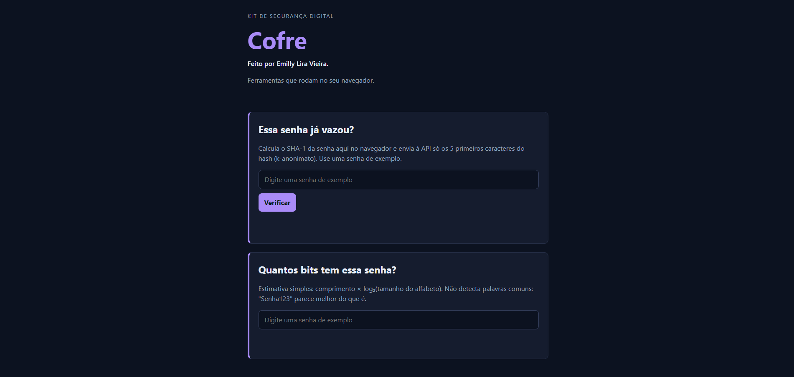

# Cofre: kit de segurança digital

**Veja funcionando:** https://emillylv98.github.io/cofre/

## O que é

O Cofre é um kit de segurança digital desenvolvido em HTML, CSS e JavaScript. Ele permite verificar se uma senha já foi exposta em vazamentos de dados e avaliar sua força, tudo isso sem transmitir a senha pela internet, garantindo mais privacidade e segurança ao usuário.

## Ferramentas

- **Essa senha já vazou?** Consulta uma base real de senhas vazadas sem enviar a senha (k-anonimato).
- **Quantos bits tem essa senha?** Estima a força da senha.
- **Gerador de senhas:** cria senhas aleatórias e fortes, do tamanho que você escolher.

## O que eu aprendi

- Usar branch e merge para testar sem estragar a versão principal.
- Resolver um conflito quando dois branches mudam a mesma linha.
- Desfazer um erro com `git revert`, sem apagar o histórico.

## Tecnologias

HTML, CSS, JavaScript, Git, GitHub Pages e a API Pwned Passwords.

## Sobre o histórico

O histórico tem um arquivo `.env` com uma senha falsa, de propósito: foi um exercício para mostrar que apagar um arquivo não apaga o que já foi publicado no Git.

## Créditos

Código-base do Prof. Mario Rebello, na disciplina Introdução à Ciência da Computação (2026/2).
A ferramenta Gerador de senhas é de minha autoria. Licença MIT.
